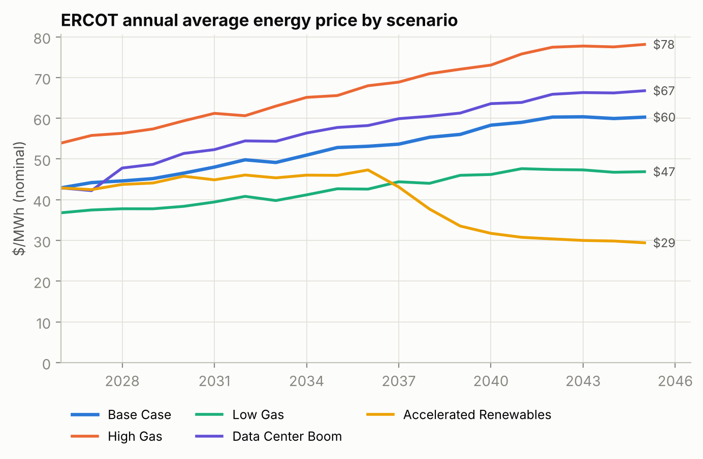
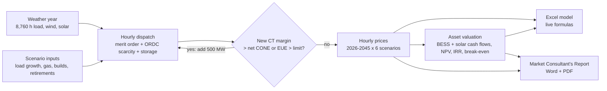

# Data Centers, Scarcity and Storage: ERCOT market outlook & asset valuation (2026–2045)

**Research question:** *How does data center load growth reshape ERCOT power prices and the relative value of battery storage versus solar?*

This repository is a small, transparent version of the workflow behind a **Market Consultant's Report**. An hourly production-cost and price-formation model of ERCOT (the same logic as Aurora or PROMOD, in open Python) forecasts prices across six scenarios to 2045. Those hourly prices then feed a cash-flow valuation of a 4-hour battery and a solar project. One command produces the report (Word + PDF), an Excel model with live formulas, the charts and CSV outputs.

| Deliverable | File |
|---|---|
| Market Consultant's Report (10 pages) | [`outputs/ERCOT_Market_Consultant_Report.pdf`](outputs/ERCOT_Market_Consultant_Report.pdf) / [`.docx`](outputs/ERCOT_Market_Consultant_Report.docx) |
| Excel model (assumptions, forecast, 8,760-hour detail, live-formula valuations, sensitivities) | [`outputs/ERCOT_Market_Outlook_Model.xlsx`](outputs/ERCOT_Market_Outlook_Model.xlsx) |
| Annual forecast, all scenarios | [`outputs/annual_forecast.csv`](outputs/annual_forecast.csv) |
| Asset valuations, all scenarios | [`outputs/asset_valuations.csv`](outputs/asset_valuations.csv) |
| Charts | [`outputs/charts/`](outputs/charts) |

> **Data notice.** This sandbox had no access to ERCOT or EIA APIs, so the hourly load, wind and solar *shapes* are synthetic. They are calibrated to public ERCOT statistics: about 505 TWh and 88 GW peak in 2026, 36% wind and 25% solar capacity factors, a summer-afternoon peak and a winter cold-snap stress event. `profiles.load_profiles_csv()` swaps in real hourly data with no other code changes. The findings describe market *mechanisms*. They are not a price forecast to transact on.

---

## Key findings



| Scenario | 2026 | 2030 | 2035 | 2045 | Battery NPV ($/kW) | Battery IRR | Solar NPV ($/kW) | Solar IRR |
|---|---|---|---|---|---|---|---|---|
| Base Case | $42.9 | $46.5 | $52.8 | $60.3 | -$306 | -1.8% | -$318 | 0.8% |
| High Gas (+40%) | $53.9 | $59.4 | $65.6 | $78.1 | -$294 | -1.0% | -$125 | 5.2% |
| Low Gas (-30%) | $36.8 | $38.4 | $42.7 | $46.9 | -$322 | -2.6% | -$448 | -3.7% |
| Data Center Boom (+12 GW 24x7 load) | $42.9 | $51.4 | $57.7 | $66.8 | -$360 | -4.2% | -$203 | 3.7% |
| Data Center, Slow Build (entry capped at 2 GW/yr) | $42.9 | **$279** | $66.2 | $66.8 | **$658** | **25.9%** | -$43 | 6.7% |
| Accelerated Renewables | $42.9 | $45.8 | $46.0 | $29.4 | -$327 | n/m | -$494 | n/m |

*Average energy price, nominal $/MWh. Merchant NPV at a 7.5% after-tax WACC.*

1. **Data center load raises prices by less than you might expect, as long as new supply keeps pace.** In this model ERCOT's energy-only market builds about 14 GW of extra peaking capacity by 2030. That holds the price increase to roughly +$5/MWh.
2. **Solar gains more than batteries.** Flat 24x7 load lifts midday and overnight prices (the floor of the price curve) more than the evening peak. Solar capture prices rise from about $34 to $41/MWh. The intraday spread a battery earns on narrows from $54 to $47/MWh.
3. **Batteries are a bet on how fast new supply arrives, not on load growth itself.** If new gas entry is constrained, a 2028–2033 scarcity window opens and battery IRR rises to about 26%.
4. **Neither asset works on a fully merchant basis in the Base Case.** Solar needs a PPA of about $52/MWh, and a battery needs about $95/kW-yr (about $8/kW-month as a toll). This matches how ERCOT projects are actually financed.

---

## How the model works



| Module | What it does |
|---|---|
| [`assumptions.py`](src/marketmodel/assumptions.py) | Market rules ($5,000 cap, ORDC parameters, offer behavior), 2026 fleet, gas strip, and six scenario trajectories |
| [`profiles.py`](src/marketmodel/profiles.py) | Weather-driven hourly load (CDD/HDD), wind (seasonal + nocturnal jet + weather regimes) and solar (clear-sky geometry x clouds); CSV loader for real data |
| [`dispatch.py`](src/marketmodel/dispatch.py) | Vectorized 8,760-hour economic dispatch: nuclear/must-run → wind (PTC offers below $0) → solar → about 34 thermal heat-rate blocks; ORDC adder `(VOLL − λ)·LOLP(reserves)`; battery fleet peak-shave/valley-fill; seasonal and cold-weather outages |
| [`forecast.py`](src/marketmodel/forecast.py) | 20-year runs with **endogenous capacity entry**: a new CT is dispatched against simulated prices and built while its margin exceeds net CONE, which keeps prices in long-run equilibrium |
| [`valuation.py`](src/marketmodel/valuation.py) | Price-taker BESS arbitrage + declining ancillary revenue; merchant solar with negative-price curtailment; after-tax cash flows (ITC, 5-yr MACRS); NPV, IRR, closed-form break-even, tornado sensitivities |
| [`workbook.py`](src/marketmodel/workbook.py) | Excel model. The valuation sheets use **live formulas** (edit capex, WACC or ITC and NPV/IRR recalculate). Recalculated in LibreOffice, the Excel NPV matches Python to within $0.01 |
| [`report.py`](src/marketmodel/report.py) | Generates the report; every number in the text is pulled from model output, so the report and workbook cannot drift apart |

The full study (6 scenarios × 20 years × 8,760 hours ≈ 1.05 million simulated hours, including capacity-entry iterations) runs in about 8 seconds.

---

## Run it

```bash
pip install -e ".[dev]"
pytest -q                                   # 19 tests: dispatch, ORDC, storage, energy balance, valuation, entry
python -m marketmodel.pipeline --out outputs
# optional: real ERCOT hourly data (timestamp, load_mw, wind_mw, solar_mw, wind_capacity_mw, solar_capacity_mw)
python -m marketmodel.pipeline --out outputs --profiles data/ercot_2024_hourly.csv
```

CI (GitHub Actions) runs lint and tests, then runs the full study on Python 3.11 and 3.12 and uploads the outputs as a build artifact.

## What the tests check

- The energy balance holds in every hour (generation + storage + unserved = load + charging)
- Prices stay between the floor and the $5,000 cap; the ORDC adder decreases as reserves rise and hits the cap at the 3,000 MW minimum level
- The battery schedule respects power and energy limits, and round-trip losses are positive
- Higher gas prices or higher load mean higher prices; solar captures less than the average price (cannibalization)
- Battery revenue matches a hand calculation; IRR is the rate at which NPV = 0; break-even revenue gives NPV = 0; the ITC basis reduction is applied
- Capacity entry keeps unserved energy within the reliability limit, and constrained entry produces scarcity

## Limitations (and what a production study would add)

- **Synthetic weather year.** Use historical ERCOT load and generation by fuel, or licensed Aurora/PROMOD databases, with multiple weather years for P10/P50/P90 ranges.
- **Zonal, not nodal.** Hub and node basis matters a great deal for West Texas renewables and is not modeled.
- **Ancillary services are exogenous**, not co-optimized with energy as in ERCOT's real-time co-optimization.
- **Battery dispatch uses daily perfect foresight** with an 85% capture haircut. Unit commitment, start costs and ramp limits are simplified.
- **Tax credits.** A 30% ITC is assumed for both assets. Eligibility under recent federal law changes and FEOC rules is a first-order diligence item; the tornado charts show it is the largest single value driver.

## Skills demonstrated

| Skill | Where it shows up |
|---|---|
| Asset and portfolio market projections and valuation | 20-year hourly price forecast; BESS and solar NPV/IRR/break-even across scenarios |
| Drafting Market Consultant's Reports | `outputs/ERCOT_Market_Consultant_Report.pdf`, structured for utilities, developers, lenders and ESCOs |
| Modeling generation assets with simulation tools (Aurora, ProMod) | Merit-order dispatch, ORDC scarcity pricing, storage, and capacity-expansion logic mirroring those tools |
| Knowledge of US regional power markets | ERCOT energy-only design, ORDC, PTC-driven negative offers, cold-weather risk, large-load growth |
| Excel for ad hoc analysis | Workbook with live cash-flow formulas, scenario tables, charts and 8,760-hour detail |
| New approaches to emerging issues | Data center load growth and the speed of the supply response as the main driver of storage value |

---

*Author: Tanisha Raskar. Built as an independent portfolio project; independent research study, not affiliated with or endorsed by ERCOT.*
